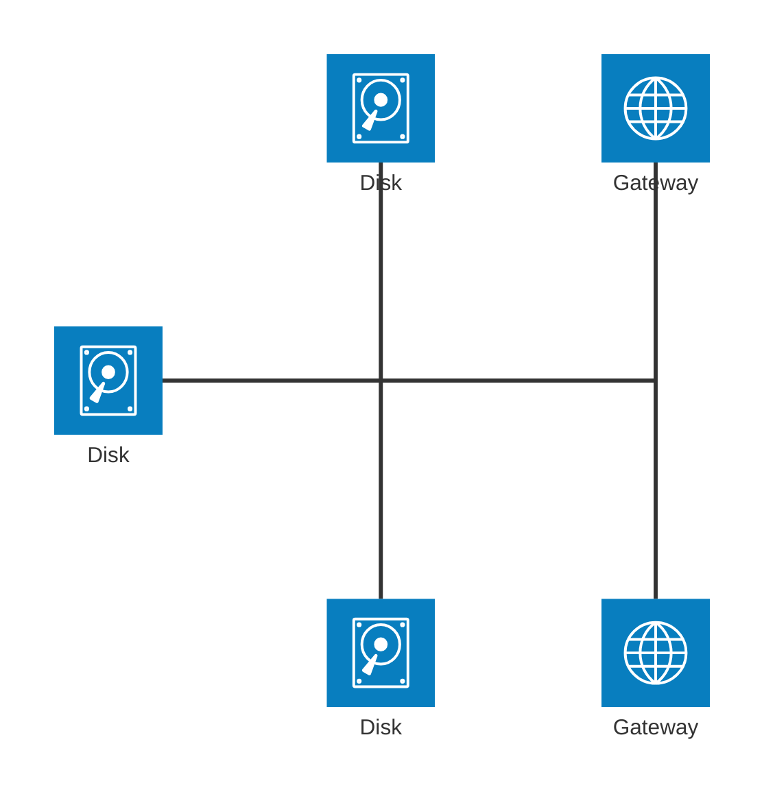

> 快照：<https://pele.run/examples/architecture> · Pele 1.13.0 · 抓取于 2026-11-04。内容原样保留，未做删改。

## Narrow screens

### Fixed link sides

Labels and spacing tighten; the specified link sides and grid alignments stay in place.

## Documentation examples

```mermaid
architecture-beta
    group api(logos:aws-lambda)[API]

    service db(logos:aws-aurora)[Database] in api
    service disk1(logos:aws-glacier)[Storage] in api
    service disk2(logos:aws-s3)[Storage] in api
    service server(logos:aws-ec2)[Server] in api

    db:L -- R:server
    disk1:T -- B:server
    disk2:T -- B:db
```

