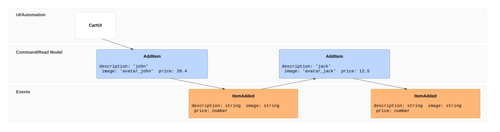
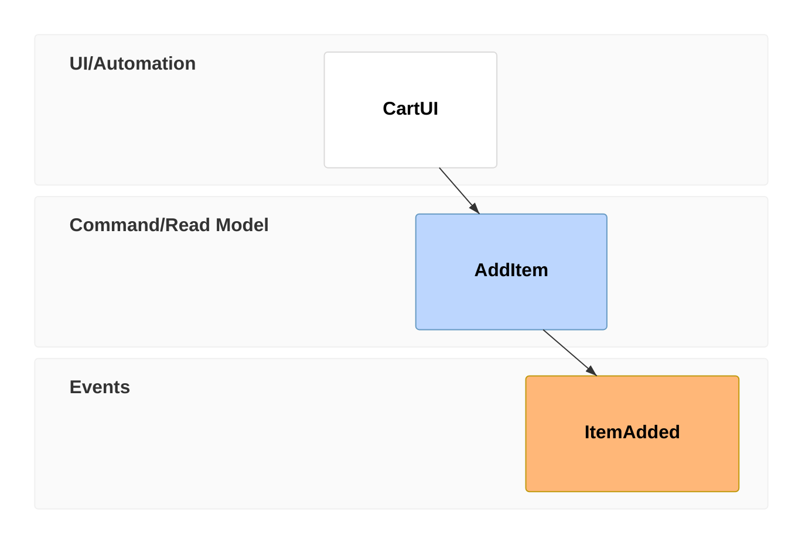
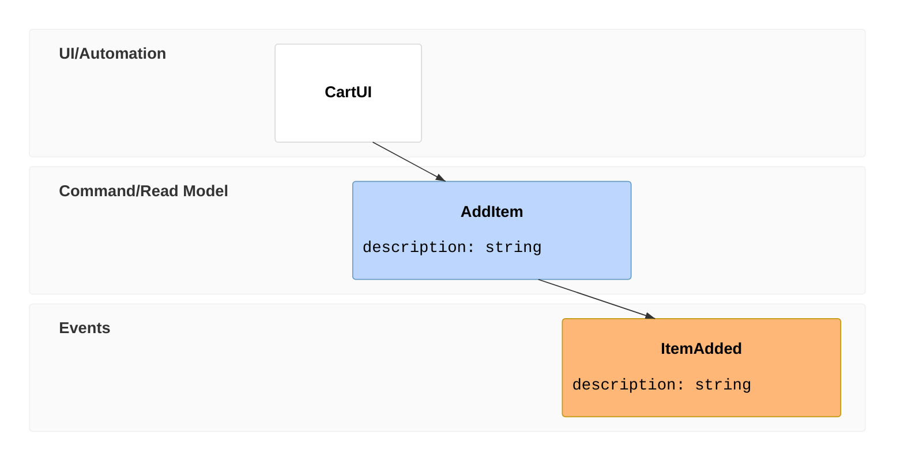
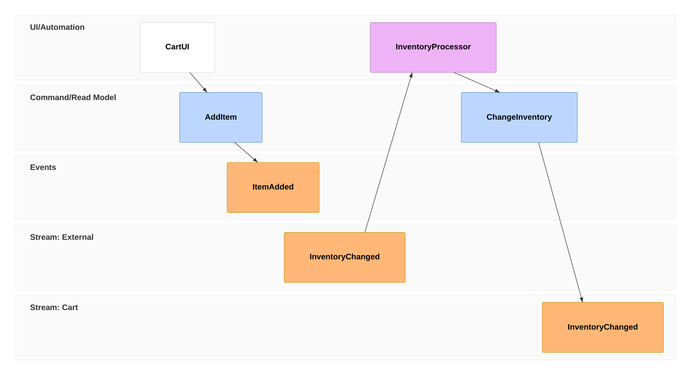
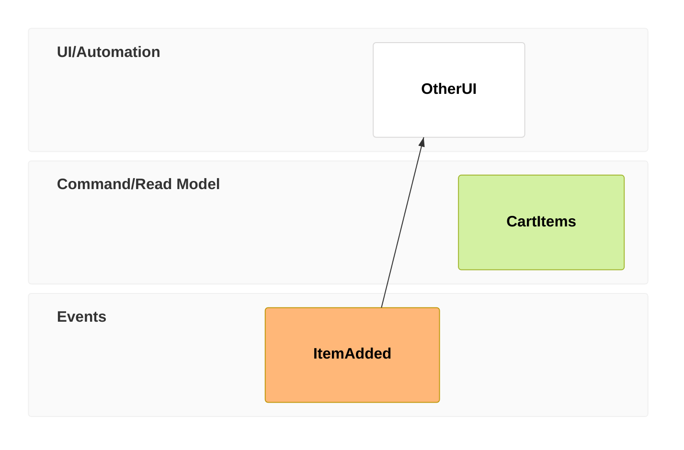
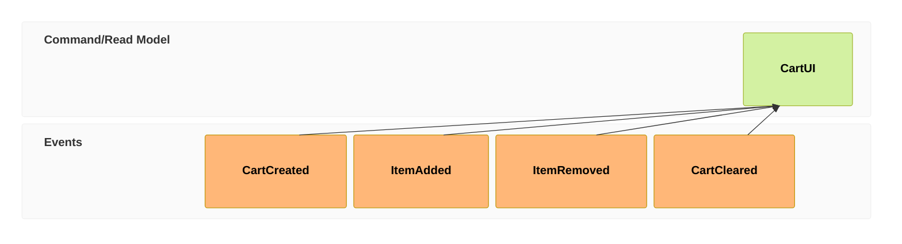
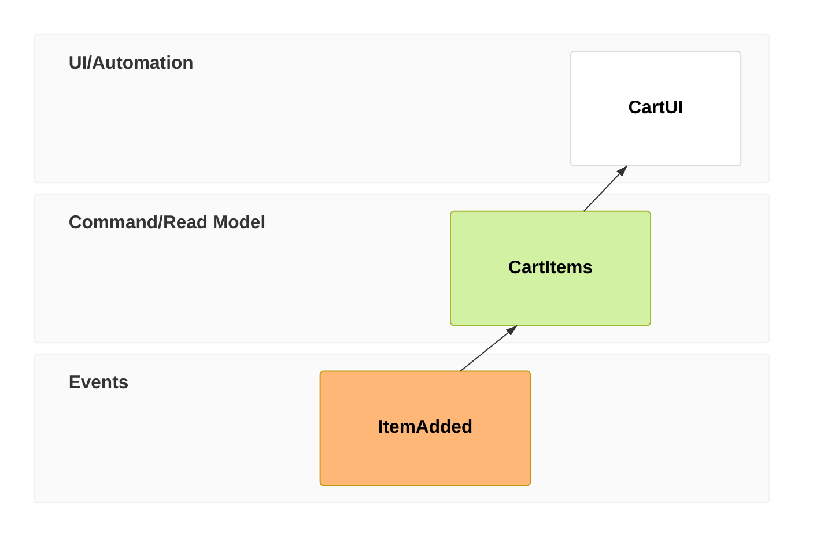
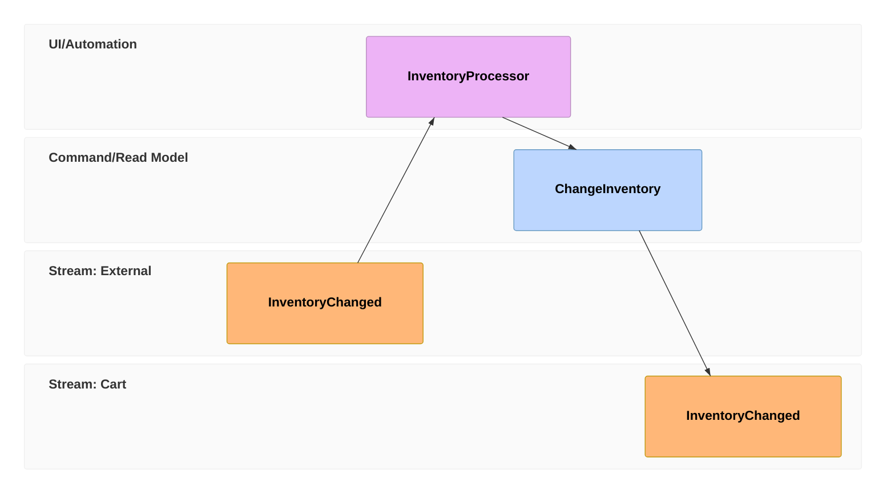
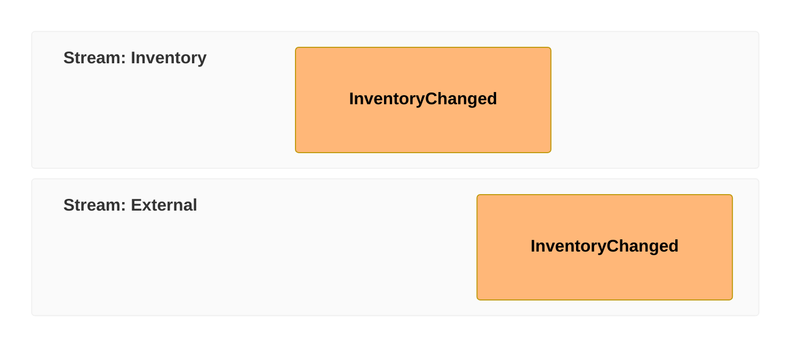

> 快照：<https://pele.run/examples/eventmodeling> · Pele 1.13.0 · 抓取于 2026-11-04。内容原样保留，未做删改。

## Narrow screens

### Chronological frames

Frames run down the page, with their lane labels, data and references.

## Documentation examples

