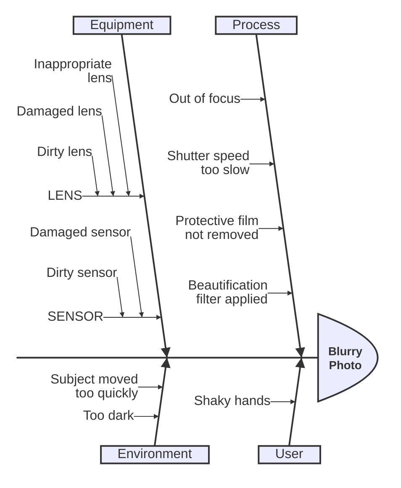

> 快照：<https://pele.run/examples/ishikawa> · Pele 1.13.0 · 抓取于 2026-11-04。内容原样保留，未做删改。

## Narrow screens

### Categories and causes

The narrow view is a cause tree that preserves the categories and nested causes.

## Documentation examples

