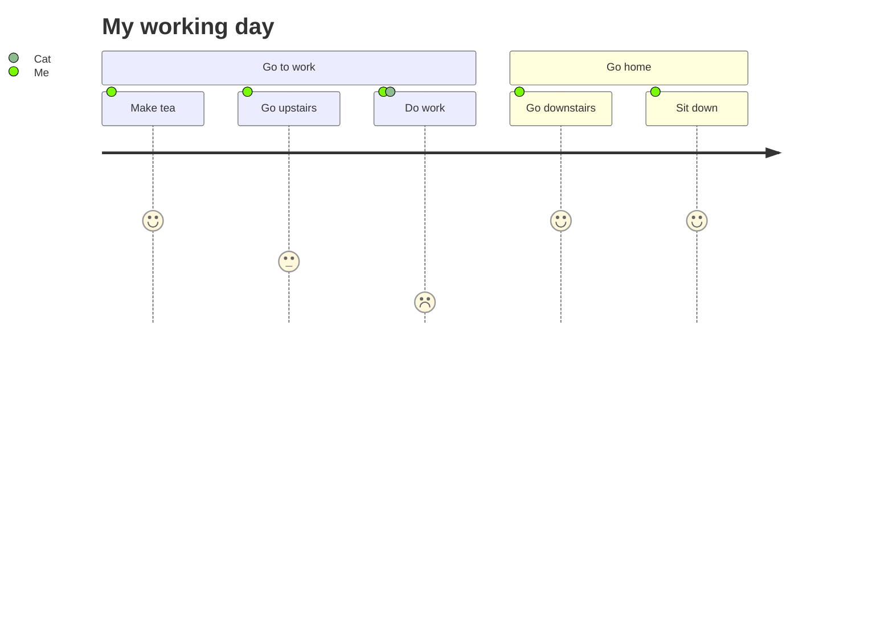

> 快照：<https://pele.run/examples/journey> · Pele 1.13.0 · 抓取于 2026-11-04。内容原样保留，未做删改。

## Narrow screens

### Journey steps

On a narrow screen, each step keeps its score, mood and actors in a vertical sequence.

## Documentation examples

