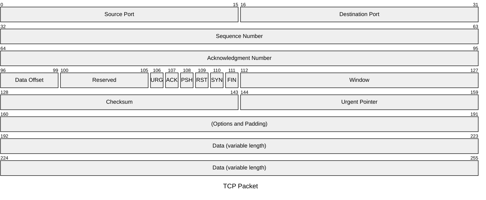
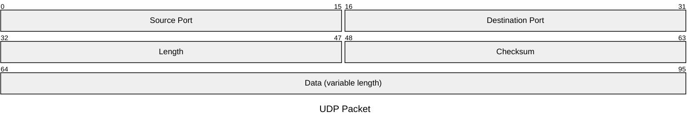
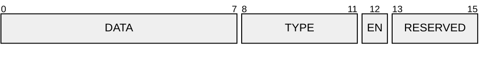
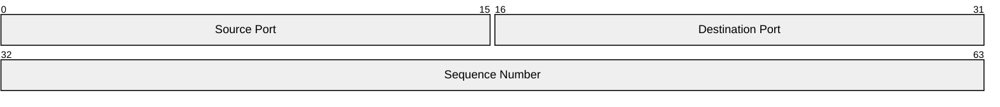

> 快照：<https://pele.run/examples/packet> · Pele 1.13.0 · 抓取于 2026-11-04。内容原样保留，未做删改。

## Narrow screens

### Protocol fields

Shorter rows preserve bit numbers. A row grows taller when a field label needs to wrap.

## Documentation examples

