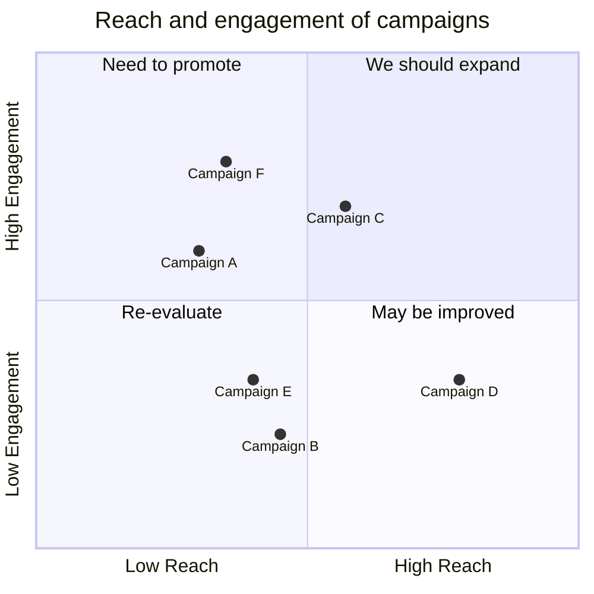
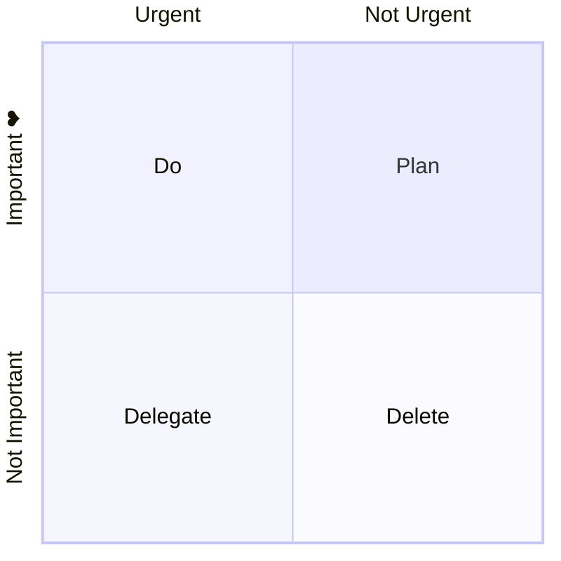
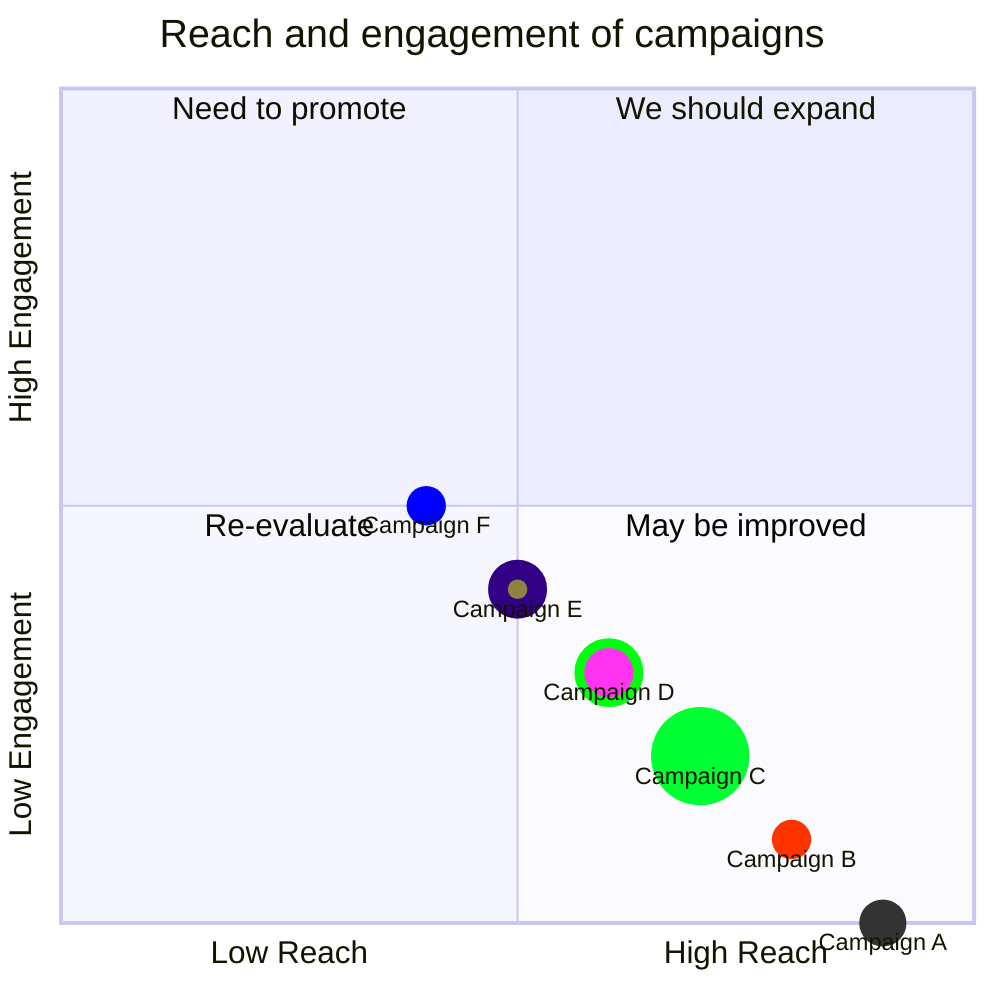

> 快照：<https://pele.run/examples/quadrant> · Pele 1.13.0 · 抓取于 2026-11-04。内容原样保留，未做删改。

## Narrow screens

### Quadrant labels

The chart fits a phone width and wraps its labels.

## Documentation examples

