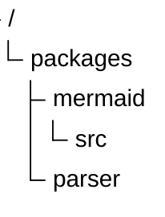
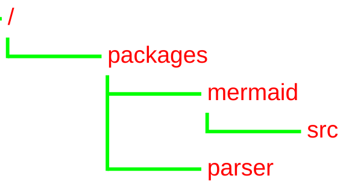

> 快照：<https://pele.run/examples/treeview> · Pele 1.13.0 · 抓取于 2026-11-04。内容原样保留，未做删改。

## Narrow screens

### Names and descriptions

Long filenames wrap. Descriptions move beneath their entries and the hierarchy remains visible.

## Documentation examples

